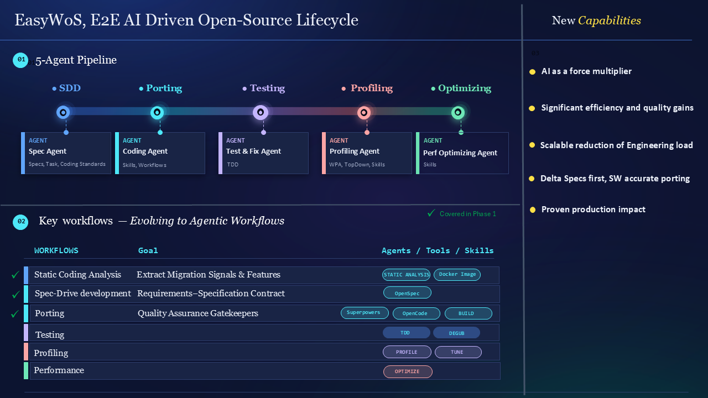

# EasyWoS

**EasyWoS** is an end-to-end solution that helps migrate software from the x86 architecture to the ARM64 architecture. Through static code scanning, it detects potential incompatible code issues, maps these issues to skills, and lets users complete the entire code migration simply by running /ospx:apply. By combining the capabilities of static code scanning, OpenSpec, and skills, EasyWoS provides users with a complete, end-to-end solution for code migration and performance optimization.

---

## Features

| Feature | Description | Status |
|---|---|---|
| **Code Compatibility Scanning** | Scans C/C++/Assembly source code for ARM64/ARM64EC compatibility issues, supporting upload and Git repository input | ✅ Available |
| **EasyBuild** | Step-by-step guide for cross-compiling Windows on Arm applications (ARM64/ARM64EC) on x86-64 host machines using MSVC or LLVM toolchains | ✅ Available |
| **Performance Evaluation** | Integration with the Qualcomm Top-Down Tool (WPA plugin) for PMU-based CPU microarchitecture performance analysis | ✅ Available |
| **Performance Optimization** | Advanced optimization recommendations | 🚧 Coming Soon |

---

## EasyWoS End-to-End lifecycle

---

## EasyWoS Skills

`easywos-skills`, located under [`agent/`](agent/), is a skill tree for AI coding agents that ports x86/x64 code to Windows on Snapdragon (ARM64 and ARM64EC).

It combines EasyWoS scan-result orchestration with focused migration skills covering:

- SSE/AVX intrinsics to ARM NEON
- x64 assembly to AArch64
- ARM64 and ARM64EC build-system enablement
- ARM64EC JIT executable-memory handling
- Porting verification and report generation
- Performance profiling and optimization

### Workflow

The skills follow an end-to-end migration workflow:

1. Generate or provide an EasyWoS ARM64 porting YAML report.
2. Match scan findings to migration specifications with `easywos-spec`.
3. Route matched items to specialized skills with `dispatcher-skill`.
4. Generate and apply the ARM64 implementation changes.
5. Build and run the generated verification workflow.
6. Profile, optimize, and archive the final result when required.

The migration must be performed through the complete skill flow:

```text
EasyWoS scan
    → easywos-spec
    → dispatcher-skill
    → specialized leaf skills
    → build and verification
```

If the generated result needs improvement, update the relevant skill or specification so that the workflow itself produces the improved implementation instead of bypassing the skill pipeline.

### Core Skills

| Skill | Purpose |
|---|---|
| `arm64-port-orchestrator` | Runs the complete scan, port, verify, build, test, fix, profile, and archive lifecycle |
| `easywos-spec` | Converts EasyWoS scan findings into matched porting tasks |
| `dispatcher-skill` | Routes matched tasks to specialized migration skills |
| `sse-avx-to-neon` | Converts SSE/AVX intrinsics to ARM NEON |
| `intrinsics-x64-to-arm64` | Guides Windows C++ SIMD migration |
| `asm-x64-to-arm64` | Converts x64 inline or MASM assembly to AArch64 |
| `enable-windows-arm64` | Adds ARM64 support to project build systems |
| `jit-arm64ec-virtualalloc-fix-skill` | Handles ARM64EC JIT executable-memory requirements |
| `arm64-porting-report` | Generates migration reports |
| `etl-generator`, `perf-sampling-parser`, `perf-optimizer` | Capture, analyze, and optimize application performance |

### Installation

Install all EasyWoS skills for every detected AI coding agent:

```bash
npx skills add qualcomm/EasyWoS/agent --all
```

Alternatively, use the full repository URL:

```bash
npx skills add https://github.com/qualcomm/EasyWoS/tree/main/agent --all
```

Re-run the installation command after repository updates to receive new or updated skills.

### Prerequisites

Depending on the selected workflow, the following tools may be required:

- Node.js
- OpenSpec CLI
- CMake 3.14 or newer
- An ARM64, ARM64EC, or AArch64-capable build environment
- MSVC, Clang, GCC, or another suitable target compiler

For complete installation instructions, workflow details, and examples, see [`agent/USAGE.md`](agent/USAGE.md).

---

## Tech Stack

### Backend
- **Framework**: [Sanic](https://sanic.dev/) (async Python web framework)
- **Database**: SQLite via SQLAlchemy 2.0 + aiosqlite
- **Authentication**: JWT (sanic-jwt)
- **Remote Execution**: asyncssh / Fabric for SSH-based machine management
- **Report Generation**: Jinja2 HTML templates

### Frontend
- **Framework**: React 18 + Vite 5
- **UI Library**: Ant Design 5
- **Routing**: React Router 7

### Scanner
- C/C++/ASM compatibility advisor based on ARM64 porting analysis tools
- Supports scanning from uploaded archives (`.zip`, `.rar`, `.tar`, `.tar.gz`, `.tar.xz`) or Git repositories
- Generates HTML and JSON scan reports

---

## Requirements

Only **Docker** is required. All dependencies are bundled in the Docker image.

| Requirement | Minimum | Recommended |
|---|---|---|
| Docker | 17.05 (multi-stage build support) | 20.10+ (LTS, BuildKit enabled by default) |

---

## Quick Start

### 1. Build the Docker Image

```bash
git clone https://github.com/qualcomm/EasyWoS.git
cd EasyWoS
# The tag is easywos:latest and it will be used in the next step
docker build -t easywos:latest .
```

### 2. Run the Container

```bash
# Replace /your/local/workspace with your desired host workspace path
docker run -itd \
  -p 8888:8888 \
  -v /your/local/workspace:/app/workspace \
  --name easywos-container \
  easywos:latest
```

### 3. Access the Application

Open your browser and navigate to:

```
http://localhost:8888
```

### 4. Log In

A default admin account is pre-configured. Use the following credentials to log in:

| Field | Value |
|---|---|
| Username | `admin` |
| Password | `easywos` |

> 💡 These are the default credentials for users outside of Qualcomm.

---

## API Overview

The REST API is available under the `/api` prefix. All endpoints (except authentication) require a JWT Bearer token.

| Prefix | Description |
|---|---|
| `/api/user` | User registration and authentication |
| `/api/machine` | Remote machine (SSH) management |
| `/api/task` | Code compatibility scan task lifecycle |
| `/api/file` | File upload and storage management |
| `/api/evaluation` | Performance evaluation task management |

Interactive API documentation (OpenAPI/Swagger) is available at `/docs` when the server is running.

---

## Development

### Prerequisites

- Python 3.10+
- Node.js 18+
- Docker (for containerized deployment)

### Backend Setup

```bash
pip install -r requirement.txt
python main.py
```

The backend server starts on `http://0.0.0.0:8888`.

### Frontend Setup

```bash
npm install
npm run dev
```

The Vite dev server starts on `http://localhost:5173` with API requests proxied to the backend.

### Production Build

The Docker image performs a multi-stage build:
1. **Stage 1** — Builds the React frontend (`npm run build`)
2. **Stage 2** — Compiles Python dependency wheels
3. **Stage 3** — Assembles the final slim runtime image

---

## Configuration

Key settings are in `settings.py`:

| Setting | Default | Description |
|---|---|---|
| `DEBUG` | `False` | Enable debug mode |
| `DB_URL` | `sqlite+aiosqlite:///workspace/project.db` | Database connection URL |
| `JWT_SECRET_KEY` | *(change in production)* | Secret key for JWT signing |
| `JWT_EXPIRATION_DELTA` | `7200` (2 hours) | JWT token expiration in seconds |
| `REQUEST_MAX_SIZE` | `2000000000` (2 GB) | Maximum upload size |

> ⚠️ **Security Notice**: Change `SECRET` and `JWT_SECRET_KEY` before deploying to production.

---

## Branches

| Branch | Description |
|---|---|
| `main` | Primary development branch. All contributions should be based on and submitted to this branch via pull requests. |

---

## Contributing

Contributions are welcome! Please read the [CONTRIBUTING.md](CONTRIBUTING.md) guide before submitting a pull request.

---

## Getting in Contact

- [Report an Issue on GitHub](../../issues)
- [Open a Discussion on GitHub](../../discussions)
- [Email us](mailto:haozen@qti.qualcomm.com) for general questions

---

## License

EasyWoS is licensed under the [BSD-3-Clause License](https://spdx.org/licenses/BSD-3-Clause.html). See [LICENSE.txt](LICENSE.txt) for the full license text.

Copyright (c) 2026 Qualcomm Technologies, Inc. All Rights Reserved.
