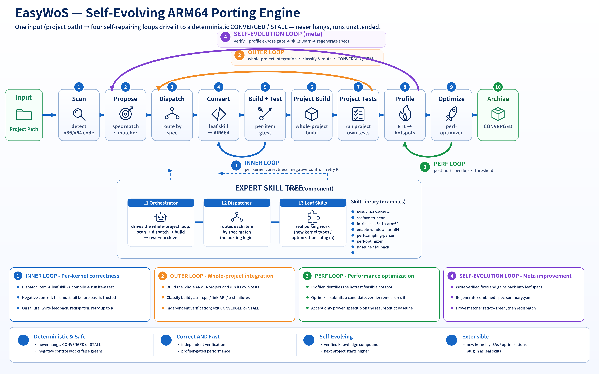
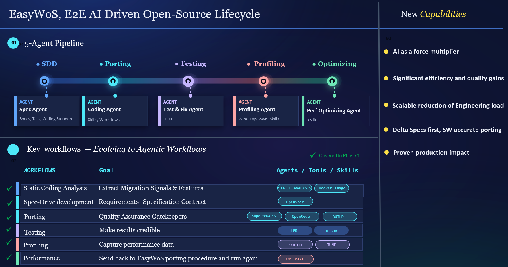

<h1 align="center">
EasyWoS
</h1>

<div align="center">
  <a href="README.zh-CN.md">中文</a> | <span>English</span>
</div>

### [Watch the demo video](demo/easywos-dev-demo.mp4)

**EasyWoS is an end-to-end porting solution, not a collection of one-off converters.** It takes a project from *un-analyzed x64 source* to a *ported, verified, measured ARM64 build* — and every stage in between is part of the product:

```
scan → plan → route → port → verify → integrate → build → test → fix → profile → optimize → capture
```


**EasyWoS** helps move software from x86/x64 to Windows on Snapdragon (ARM64 and ARM64EC). It combines two complementary parts:

1. **Static code analysis** — a Web application that scans C, C++, and assembly projects, identifies architecture-dependent code, and produces ARM64 compatibility reports from uploaded source archives or Git repositories.
2. **LLM-driven end-to-end porting** — `easywos-skills` under [`agent/`](agent/) turns scan findings into an executable migration plan, routes each item to an expert skill, generates and verifies ARM64 changes, integrates the whole project, and iterates on correctness and performance until it reaches a deterministic terminal state.

Together, these parts take a project from architecture discovery through verified migration, whole-project testing, profiling, optimization, and evidence-backed archival.

---

## EasyWoS Architecture



EasyWoS is organized as a scan-and-port pipeline backed by a three-layer expert skill tree:

- **L1 orchestrator** drives the [whole-project lifecycle](#easywos-end-to-end-lifecycle): scan, propose, dispatch, integrate, build, test, profile, optimize, and archive.
- **L2 dispatcher** consumes the specification matches for each finding and routes it to the appropriate leaf skill without embedding porting logic itself.
- **L3 leaf skills** perform the actual migration work, including SSE/AVX-to-NEON translation, x64 assembly conversion, ARM64/ARM64EC build enablement, JIT fixes, and performance optimization.

Four feedback loops make the pipeline self-repairing:

- The **inner loop** builds and tests each migrated kernel, applies a mandatory negative control, and redispatches failures with structured feedback up to a bounded retry limit.
- The **outer loop** integrates the migrated code into the real project, runs the whole ARM64 build and the project's own tests, then classifies and repairs integration failures.
- The **performance loop** profiles the real port, identifies actionable hotspots, accepts only independently verified speedups, and repeats until performance converges or no safe improvement remains.
- The **self-evolution loop** feeds verified fixes and measured optimization lessons back into the specifications and skill library so later projects start from a stronger baseline.

All loops are bounded and evidence-driven. A run finishes as `CONVERGED` or `STALLED` rather than hanging indefinitely, and archive gates prevent unverified results from being treated as complete.

---

## EasyWoS End-to-End Lifecycle



The lifecycle progresses through code scanning, spec matching, expert dispatch, per-item conversion and verification, whole-project integration, project-native testing, profiling, optimization, and archival.

---

## Features

| Area | Feature | What it provides | Status |
|---|---|---|---|
| Static analysis | **Code Compatibility Scanning** | Scans C/C++/assembly source for ARM64 and ARM64EC compatibility issues from uploaded archives or Git repositories, then generates HTML, JSON, and porting-oriented reports. | ✅ Available |
| Static analysis | **EasyBuild** | Guides cross-compilation of Windows on Arm applications on x86-64 hosts with MSVC or LLVM toolchains. | ✅ Available |
| Planning | **Spec Matching and Task Generation** | Decomposes large assembly inputs, screens source with concrete evidence, refines matches with an LLM, assigns confidence, and produces auditable migration tasks. | ✅ Available |
| Routing | **Expert Skill Dispatch** | Routes each finding to one or more specialized leaf skills, supports baseline fallback, and carries structured failure feedback into retries. | ✅ Available |
| Porting | **ARM64 and ARM64EC Migration** | Covers SSE/AVX-to-NEON translation, x64/MASM-to-AArch64 conversion, ARM64 inline assembly conversion, build-system enablement, and ARM64EC JIT executable-memory handling. | ✅ Available |
| Verification | **Per-Kernel Correctness Loop** | Generates item-level build and test workflows, requires red-to-green negative-control evidence, and retries failed items with a bounded budget. | ✅ Available |
| Integration | **Whole-Project Build and Test Loop** | Integrates generated kernels into the real project, runs its native ARM64 build and tests, classifies failures, and applies bounded repairs. | ✅ Available |
| Performance | **Profile-Guided Optimization** | Captures ETL traces, produces per-process CPU rankings and SpeedScope flame graphs, attributes hotspots to source, and accepts only measured, correctness-preserving improvements. | ✅ Available |
| Governance | **Deterministic Lifecycle and Archive Gates** | Records matcher, dispatch, build, test, negative-control, verifier, and performance evidence; incomplete or stale runs cannot be archived as successful. | ✅ Available |
| Evolution | **Self-Evolving Skill Library** | Feeds verified fixes and profiler-confirmed lessons back into leaf specifications, regenerating the combined spec index for future runs. | ✅ Available |

---

## EasyWoS Skills

`easywos-skills`, located under `agent/`, is **the second part of the EasyWoS project and serves as an** LLM-driven execution layer for complex x86/x64-to-ARM64 and ARM64EC migrations. It is designed for ports where code that merely compiles is not enough: the generated result must be traceable to a matched recipe, proven correct, integrated into the real build, and measured for regressions. If generated output exposes a recipe gap, the relevant skill or specification is improved and re-verified instead of bypassing the pipeline with an ad-hoc implementation.

> `easywos-skills`  can be used independently in your agent harness, such as codex and claude code.

### Skill file structure

Each subdirectory under `agent/skills/` is one skill; its directory name is the skill's
invocation name and it contains a `SKILL.md` (plus optional `scripts/`,
`references/`, `assets/`).

```text
agent/skills/
├── arm64-port-orchestrator/            # Top-level end-to-end loop: scan → port → verify → integrate → build → test → fix → profile → archive
├── easywos-spec/                       # EasyWoS scan orchestration and task generation
├── dispatcher-skill/                   # Routes matched porting items to leaf skills
├── arm64-baseline-porting/             # Baseline ARM64 correctness constraints
├── sse-avx-to-neon/                    # SSE/AVX intrinsics to NEON guidance
├── intrinsics-x64-to-arm64/            # Windows C++ SIMD migration guidance
├── asm-x64-to-arm64/                   # x64 inline/MASM assembly to AArch64 guidance
├── arm64-inlineasm-to-intrinsics/      # ARM64 inline assembly to portable intrinsics
├── enable-windows-arm64/               # Build-system ARM64 enablement guidance
├── jit-arm64ec-virtualalloc-fix-skill/ # ARM64EC JIT executable memory guidance
├── arm64-porting-report/               # Porting report generation
├── leaf-skill-creator/                 # Skill/spec scaffolding assistance
├── etl-generator/                      # Profiling: capture an ETL CPU trace of the ported binary
├── perf-sampling-parser/               # Profiling: per-process CPU usage → SpeedScope flame graph
└── perf-optimizer/                     # Profiling: flame-graph root-cause + optimization guidance
```

### Installation

Install all EasyWoS skills for every detected AI coding agent:

```bash
npx skills add qualcomm/EasyWoS/agent --all
```

Alternatively, use the full repository URL:

```bash
npx skills add https://github.com/qualcomm/EasyWoS/tree/main/agent --all
```

Re-run the installation command after repository updates to receive new or updated skills.

### Prerequisites

Depending on the selected workflow, the following tools may be required:

- Node.js
- OpenSpec CLI
- CMake 3.14 or newer
- An ARM64, ARM64EC, or AArch64-capable build environment
- MSVC, Clang, GCC, or another suitable target compiler

For installation details, operating contracts, examples, and advanced workflows, see [`agent/USAGE.md`](agent/USAGE.md).

---

## Static Analysis Web Application

The Web application is the static-analysis and project-management front end of EasyWoS. The sections below cover its implementation, deployment, API, and local development.

### Tech Stack

#### Backend

- **Framework**: [Sanic](https://sanic.dev/) (async Python Web framework)
- **Database**: SQLite via SQLAlchemy 2.0 and aiosqlite
- **Authentication**: JWT via sanic-jwt
- **Remote execution**: asyncssh and Fabric for SSH-based machine management
- **Report generation**: Jinja2 HTML templates

#### Frontend

- **Framework**: React 18 and Vite 5
- **UI library**: Ant Design 5
- **Routing**: React Router 7

#### Scanner

- C/C++/assembly compatibility advisor based on ARM64 porting analysis tools
- Source input from Git repositories or uploaded `.zip`, `.rar`, `.tar`, `.tar.gz`, and `.tar.xz` archives
- HTML and JSON scan reports

### Requirements

Only **Docker** is required for containerized use. All application dependencies are bundled in the image.

| Requirement | Minimum | Recommended |
|---|---|---|
| Docker | 17.05 (multi-stage build support) | 20.10+ (LTS, BuildKit enabled by default) |

### Quick Start

#### 1. Build the Docker Image

```bash
git clone https://github.com/qualcomm/EasyWoS.git
cd EasyWoS
docker build -t easywos:latest .
```

#### 2. Run the Container

```bash
# Replace /your/local/workspace with the desired host workspace path.
docker run -itd \
  -p 8888:8888 \
  -v /your/local/workspace:/app/workspace \
  --name easywos-container \
  easywos:latest
```

#### 3. Open the Application

Visit `http://localhost:8888`.

#### 4. Log In

A default administrator account is preconfigured:

| Field | Value |
|---|---|
| Username | `admin` |
| Password | `easywos` |

> These are the default credentials for users outside Qualcomm. Change all secrets before a production deployment.

### API Overview

The REST API is available under the `/api` prefix. All endpoints except authentication require a JWT bearer token.

| Prefix | Description |
|---|---|
| `/api/user` | User registration and authentication |
| `/api/machine` | Remote machine and SSH management |
| `/api/task` | Code compatibility scan task lifecycle |
| `/api/file` | File upload and storage management |
| `/api/evaluation` | Performance evaluation task management |

Interactive OpenAPI/Swagger documentation is available at `/docs` while the server is running.

### Development

#### Prerequisites

- Python 3.10+
- Node.js 18+
- Docker for containerized deployment

#### Backend Setup

```bash
pip install -r requirement.txt
python main.py
```

The backend server starts on `http://0.0.0.0:8888`.

#### Frontend Setup

```bash
npm install
npm run dev
```

The Vite development server starts on `http://localhost:5173` and proxies API requests to the backend.

#### Production Build

The Docker image uses a multi-stage build:

1. Build the React frontend with `npm run build`.
2. Compile Python dependency wheels.
3. Assemble the final slim runtime image.

### Configuration

Key settings are defined in `settings.py`:

| Setting | Default | Description |
|---|---|---|
| `DEBUG` | `False` | Enable debug mode |
| `DB_URL` | `sqlite+aiosqlite:///workspace/project.db` | Database connection URL |
| `JWT_SECRET_KEY` | *(change in production)* | Secret key for JWT signing |
| `JWT_EXPIRATION_DELTA` | `7200` (2 hours) | JWT token expiration in seconds |
| `REQUEST_MAX_SIZE` | `2000000000` (2 GB) | Maximum upload size |

> **Security notice:** Change `SECRET`, `JWT_SECRET_KEY`, and the default administrator password before deploying to production.

---

## Branches

| Branch | Description |
|---|---|
| `main` | Primary development branch. Base contributions on this branch and submit them through pull requests. |

---

## Contributing

Contributions are welcome. Read [CONTRIBUTING.md](CONTRIBUTING.md) before submitting a pull request.

---

## Getting in Contact

- [Report an issue on GitHub](../../issues)
- [Open a discussion on GitHub](../../discussions)
- [Email us](mailto:haozen@qti.qualcomm.com) for general questions

---

## License

EasyWoS is licensed under the [BSD-3-Clause License](https://spdx.org/licenses/BSD-3-Clause.html). See [LICENSE.txt](LICENSE.txt) for the full license text.

Copyright (c) 2026 Qualcomm Technologies, Inc. All Rights Reserved.
