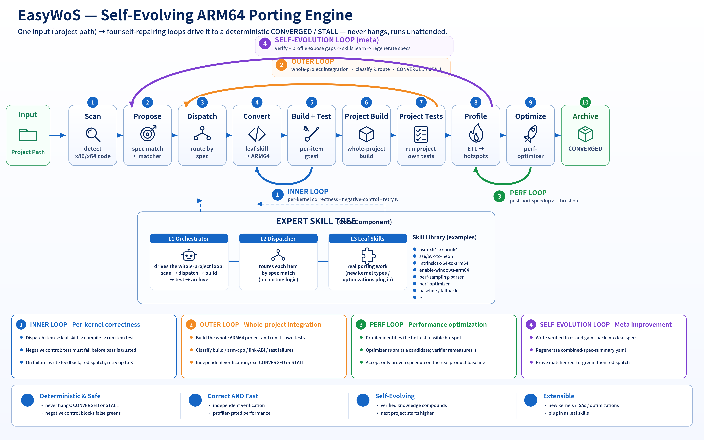
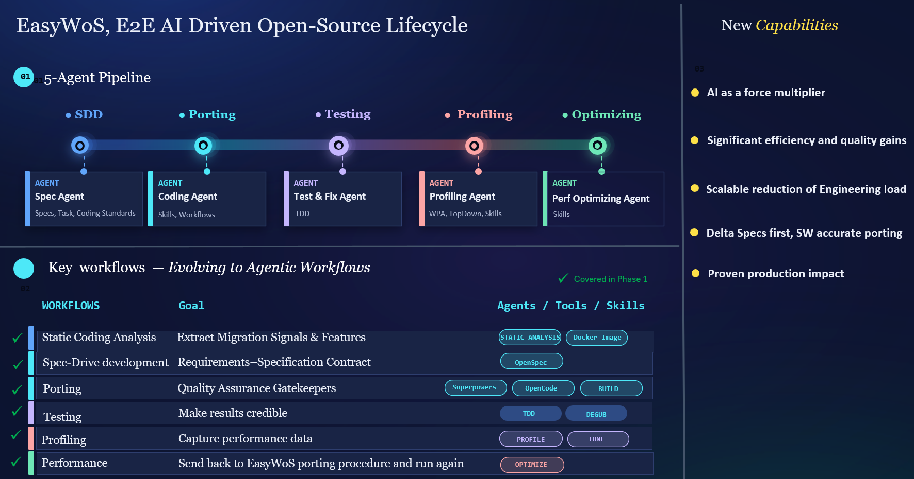

<h1 align="center">
EasyWoS
</h1>

<div align="center">
  <span>中文</span> | <a href="README.md">English</a>
</div>

### [观看演示视频](demo/easywos-dev-demo.mp4)

**EasyWoS 是一套端到端移植解决方案，而不是一组一次性的代码转换器。** 它能够将项目从*尚未分析的 x64 源代码*逐步转变为*已移植、已验证、已度量的 ARM64 构建*——中间的每一个阶段都是产品的一部分：

```
扫描 → 规划 → 路由 → 移植 → 验证 → 集成 → 构建 → 测试 → 修复 → 分析 → 优化 → 沉淀
```

**EasyWoS** 帮助开发者将软件从 x86/x64 移植到 Windows on Snapdragon（ARM64 和 ARM64EC）。它由两个互补的部分组成：

1. **静态代码分析**——一个 Web 应用程序，可扫描 C、C++ 和汇编项目，识别与体系结构相关的代码，并根据上传的源代码压缩包或 Git 仓库生成 ARM64 兼容性报告。
2. **LLM 驱动的端到端移植**——位于 [`agent/`](agent/) 下的 `easywos-skills` 将扫描结果转换为可执行的迁移计划，把每个项目路由到相应的专家技能，生成并验证 ARM64 改动，完成整个项目的集成，并持续迭代正确性与性能，直到进入确定性的终止状态。

这两个部分共同覆盖从体系结构问题发现、验证式迁移、完整项目测试，到性能分析、优化和基于证据归档的全过程。

---

## EasyWoS 架构



EasyWoS 采用扫描与移植流水线，并由三层专家技能树提供支持：

- **L1 编排器**驱动[完整项目生命周期](#easywos-端到端生命周期)：扫描、提案、分发、集成、构建、测试、性能分析、优化和归档。
- **L2 分发器**接收每个扫描项对应的规格匹配结果，并将其路由到适当的叶子技能，而不在自身内部实现移植逻辑。
- **L3 叶子技能**执行实际的迁移工作，包括 SSE/AVX 到 NEON 的转换、x64 汇编转换、ARM64/ARM64EC 构建支持、JIT 修复和性能优化。

四个反馈循环使流水线具备自修复能力：

- **内循环**构建并测试每个已迁移内核，执行强制负向控制，并携带结构化反馈重新分发失败项，直到达到有界重试上限。
- **外循环**将迁移后的代码集成到真实项目中，执行完整的 ARM64 构建和项目自身测试，然后对集成失败进行分类和修复。
- **性能循环**对真实移植结果进行性能分析，识别可操作的热点，只接受经过独立验证的性能提升，并持续重复，直到性能收敛或不存在安全的改进方案。
- **自进化循环**将经过验证的修复和实测优化经验回灌到规格与技能库中，使后续项目能够从更高的基线开始。

所有循环都有明确边界并由证据驱动。一次运行会以 `CONVERGED` 或 `STALLED` 结束，而不会无限挂起；归档门禁则阻止未经验证的结果被视为已完成。

---

## EasyWoS 端到端生命周期



该生命周期依次完成代码扫描、规格匹配、专家技能分发、逐项转换与验证、完整项目集成、项目原生测试、性能分析、优化和归档。

---

## 功能

| 领域 | 功能 | 提供的能力 | 状态 |
|---|---|---|---|
| 静态分析 | **代码兼容性扫描** | 扫描来自上传压缩包或 Git 仓库的 C/C++/汇编源代码，识别 ARM64 和 ARM64EC 兼容性问题，并生成 HTML、JSON 和面向移植的报告。 | ✅ 可用 |
| 静态分析 | **EasyBuild** | 指导开发者使用 MSVC 或 LLVM 工具链，在 x86-64 主机上交叉编译 Windows on Arm 应用程序。 | ✅ 可用 |
| 规划 | **规格匹配与任务生成** | 拆分大型汇编输入，基于具体证据筛选源代码，使用 LLM 优化匹配结果、分配置信度，并生成可审计的迁移任务。 | ✅ 可用 |
| 路由 | **专家技能分发** | 将每个扫描项路由到一个或多个专用叶子技能，支持基线回退，并在重试时传递结构化失败反馈。 | ✅ 可用 |
| 移植 | **ARM64 与 ARM64EC 迁移** | 覆盖 SSE/AVX 到 NEON 的转换、x64/MASM 到 AArch64 的转换、ARM64 内联汇编转换、构建系统支持以及 ARM64EC JIT 可执行内存处理。 | ✅ 可用 |
| 验证 | **逐内核正确性循环** | 生成逐项构建和测试流程，要求提供从红到绿的负向控制证据，并在有界重试预算内重试失败项。 | ✅ 可用 |
| 集成 | **完整项目构建与测试循环** | 将生成的内核集成到真实项目中，执行项目原生的 ARM64 构建和测试，对失败进行分类，并实施有界修复。 | ✅ 可用 |
| 性能 | **性能分析驱动的优化** | 捕获 ETL 跟踪，生成逐进程 CPU 排名和 SpeedScope 火焰图，将热点定位到源代码，并且只接受经过度量且保持正确性的改进。 | ✅ 可用 |
| 治理 | **确定性生命周期与归档门禁** | 记录匹配、分发、构建、测试、负向控制、验证者和性能证据；不完整或已过期的运行无法被归档为成功。 | ✅ 可用 |
| 进化 | **自进化技能库** | 将经过验证的修复和性能分析确认的经验回灌到叶子规格中，并重新生成组合规格索引供后续运行使用。 | ✅ 可用 |

---

## EasyWoS Skills

位于 `agent/` 下的 `easywos-skills` 是 **EasyWoS 项目的第二部分，并作为** LLM 驱动的执行层，用于完成复杂的 x86/x64 到 ARM64 和 ARM64EC 迁移。它面向仅仅“能够编译”还不足以满足要求的移植场景：生成的结果必须能够追溯到匹配的迁移方案，经过正确性证明，集成到真实构建中，并完成回归度量。如果生成结果暴露出迁移方案缺口，则改进并重新验证相关技能或规格，而不是通过临时实现绕过流水线。

> `easywos-skills` 也可以独立用于 Codex、Claude Code 等 Agent 运行环境。

### 技能文件结构

`agent/skills/` 下的每个子目录都是一个技能；目录名称即技能的调用名称，其中包含一个 `SKILL.md`，并可选择包含 `scripts/`、`references/` 和 `assets/`。

```text
agent/skills/
├── arm64-port-orchestrator/            # 顶层端到端循环：扫描 → 移植 → 验证 → 集成 → 构建 → 测试 → 修复 → 性能分析 → 归档
├── easywos-spec/                       # EasyWoS 扫描编排与任务生成
├── dispatcher-skill/                   # 将匹配的移植项路由到叶子技能
├── arm64-baseline-porting/             # ARM64 正确性基线约束
├── sse-avx-to-neon/                    # SSE/AVX 内在函数到 NEON 的迁移指导
├── intrinsics-x64-to-arm64/            # Windows C++ SIMD 迁移指导
├── asm-x64-to-arm64/                   # x64 内联汇编/MASM 到 AArch64 的迁移指导
├── arm64-inlineasm-to-intrinsics/      # ARM64 内联汇编到可移植内在函数
├── enable-windows-arm64/               # 构建系统 ARM64 支持指导
├── jit-arm64ec-virtualalloc-fix-skill/ # ARM64EC JIT 可执行内存指导
├── arm64-porting-report/               # 移植报告生成
├── leaf-skill-creator/                 # 技能/规格脚手架辅助
├── etl-generator/                      # 性能分析：捕获已移植二进制文件的 ETL CPU 跟踪
├── perf-sampling-parser/               # 性能分析：逐进程 CPU 使用率 → SpeedScope 火焰图
└── perf-optimizer/                     # 性能分析：火焰图根因分析与优化指导
```

### 安装

为所有检测到的 AI 编码 Agent 安装全部 EasyWoS 技能：

```bash
npx skills add qualcomm/EasyWoS/agent --all
```

也可以使用完整的仓库 URL：

```bash
npx skills add https://github.com/qualcomm/EasyWoS/tree/main/agent --all
```

仓库更新后，请重新运行安装命令以获取新增或更新后的技能。

### 前置条件

根据所选工作流，可能需要以下工具：

- Node.js
- OpenSpec CLI
- CMake 3.14 或更高版本
- 支持 ARM64、ARM64EC 或 AArch64 的构建环境
- MSVC、Clang、GCC 或其他适用于目标平台的编译器

有关完整的安装说明、运行约定、示例和高级工作流，请参阅 [`agent/USAGE.md`](agent/USAGE.md)。

---

## 静态分析 Web 应用程序

该 Web 应用程序是 EasyWoS 的静态分析和项目管理前端。以下章节介绍其实现、部署、API 和本地开发方式。

### 技术栈

#### 后端

- **框架**：[Sanic](https://sanic.dev/)（异步 Python Web 框架）
- **数据库**：通过 SQLAlchemy 2.0 和 aiosqlite 使用 SQLite
- **身份验证**：通过 sanic-jwt 使用 JWT
- **远程执行**：使用 asyncssh 和 Fabric 进行基于 SSH 的机器管理
- **报告生成**：Jinja2 HTML 模板

#### 前端

- **框架**：React 18 和 Vite 5
- **UI 库**：Ant Design 5
- **路由**：React Router 7

#### 扫描器

- 基于 ARM64 移植分析工具的 C/C++/汇编兼容性顾问
- 支持 Git 仓库，以及上传的 `.zip`、`.rar`、`.tar`、`.tar.gz` 和 `.tar.xz` 源代码压缩包
- 生成 HTML 和 JSON 扫描报告

### 要求

容器化使用仅需要 **Docker**。所有应用程序依赖项均已包含在镜像中。

| 要求 | 最低版本 | 推荐版本 |
|---|---|---|
| Docker | 17.05（支持多阶段构建） | 20.10+（LTS，默认启用 BuildKit） |

### 快速开始

#### 1. 构建 Docker 镜像

```bash
git clone https://github.com/qualcomm/EasyWoS.git
cd EasyWoS
docker build -t easywos:latest .
```

#### 2. 运行容器

```bash
# 将 /your/local/workspace 替换为所需的主机工作区路径。
docker run -itd \
  -p 8888:8888 \
  -v /your/local/workspace:/app/workspace \
  --name easywos-container \
  easywos:latest
```

#### 3. 打开应用程序

访问 `http://localhost:8888`。

#### 4. 登录

系统预先配置了一个默认管理员账户：

| 字段 | 值 |
|---|---|
| 用户名 | `admin` |
| 密码 | `easywos` |

> 这是为 Qualcomm 外部用户提供的默认凭据。生产部署前请更改所有密钥和凭据。

### API 概览

REST API 位于 `/api` 前缀下。除身份验证外，所有端点都需要 JWT Bearer Token。

| 前缀 | 说明 |
|---|---|
| `/api/user` | 用户注册与身份验证 |
| `/api/machine` | 远程机器和 SSH 管理 |
| `/api/task` | 代码兼容性扫描任务生命周期 |
| `/api/file` | 文件上传与存储管理 |
| `/api/evaluation` | 性能评估任务管理 |

服务器运行时，可通过 `/docs` 访问交互式 OpenAPI/Swagger 文档。

### 开发

#### 前置条件

- Python 3.10+
- Node.js 18+
- 用于容器化部署的 Docker

#### 后端设置

```bash
pip install -r requirement.txt
python main.py
```

后端服务器启动于 `http://0.0.0.0:8888`。

#### 前端设置

```bash
npm install
npm run dev
```

Vite 开发服务器启动于 `http://localhost:5173`，并将 API 请求代理到后端。

#### 生产构建

Docker 镜像采用多阶段构建：

1. 使用 `npm run build` 构建 React 前端。
2. 编译 Python 依赖项 wheel。
3. 组装最终的精简运行时镜像。

### 配置

关键设置定义在 `settings.py` 中：

| 设置 | 默认值 | 说明 |
|---|---|---|
| `DEBUG` | `False` | 启用调试模式 |
| `DB_URL` | `sqlite+aiosqlite:///workspace/project.db` | 数据库连接 URL |
| `JWT_SECRET_KEY` | *（生产环境中请更改）* | JWT 签名密钥 |
| `JWT_EXPIRATION_DELTA` | `7200`（2 小时） | JWT Token 过期时间（秒） |
| `REQUEST_MAX_SIZE` | `2000000000`（2 GB） | 最大上传大小 |

> **安全提示：** 在生产部署前，请更改 `SECRET`、`JWT_SECRET_KEY` 和默认管理员密码。

---

## 分支

| 分支 | 说明 |
|---|---|
| `main` | 主开发分支。所有贡献都应基于此分支，并通过 Pull Request 提交。 |

---

## 贡献

欢迎贡献。提交 Pull Request 前，请阅读 [CONTRIBUTING.md](CONTRIBUTING.md)。

---

## 联系我们

- [在 GitHub 上报告问题](../../issues)
- [在 GitHub 上发起讨论](../../discussions)
- 一般问题请[发送电子邮件](mailto:haozen@qti.qualcomm.com)

---

## 许可证

EasyWoS 采用 [BSD-3-Clause License](https://spdx.org/licenses/BSD-3-Clause.html)。完整许可证文本请参阅 [LICENSE.txt](LICENSE.txt)。

Copyright (c) 2026 Qualcomm Technologies, Inc. All Rights Reserved.
